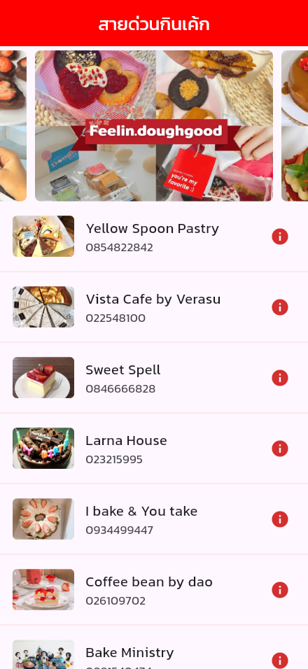
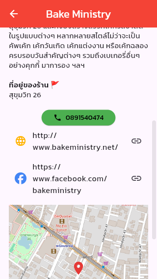

# สายด่วนกินเค้ก

สายด่วนกินเค้กเป็นแอปรวมข้อมูลร้านเค้ก 7 ร้านที่พัฒนาด้วย Flutter และ Dart ผู้ใช้เลื่อนดูแบนเนอร์ เลือกร้านเพื่อดูรูปและรายละเอียด แล้วเปิดช่องทางติดต่อหรือดูตำแหน่งร้านบนแผนที่ได้จากหน้ารายละเอียด

## ฟังก์ชันการทำงาน

- แสดงหน้าเปิดแอปพร้อมภาพพื้นหลังและตัวบอกสถานะ แล้วไปหน้ารายการหลัง 3 วินาที
- หน้ารายการแสดงรูป ชื่อ และเบอร์โทรของทั้ง 7 ร้าน พร้อมแบนเนอร์ 7 ภาพที่ปัดได้และเปลี่ยนเองทุก 3 วินาทีเมื่อระบบอนุญาตให้เล่นแอนิเมชัน
- แตะแถวร้านหรือไอคอน ⓘ เพื่อดูรูป 3 ภาพ เวลาเปิดปิด รายละเอียด และที่อยู่ร้าน กดลูกศรบน AppBar เพื่อกลับหน้ารายการ
- ปุ่มโทรส่งเบอร์ร้านให้แอปโทรศัพท์ของอุปกรณ์ ส่วนลิงก์เปิดเว็บไซต์และ Facebook ของร้าน
- เลื่อนลงเพื่อดูแผนที่ OpenStreetMap และแตะหมุดเพื่อเปิดตำแหน่งร้านใน Google Maps

## ภาพหน้าจอแอปพลิเคชัน

ภาพจาก Web build ที่รันใน Chrome headless ห้าภาพแรกตามลำดับไฟล์ใช้ขนาด 440 × 956 และภาพรายละเอียด Bake Ministry ใช้ขนาด 320 × 568

| หน้าเปิดแอป | รายการร้าน | รายละเอียดร้าน |
| :---: | :---: | :---: |
|  |  |  |

| Carousel หลังเปลี่ยนภาพ | แผนที่และข้อมูลติดต่อ | หน้าจอขนาดเล็ก |
| :---: | :---: | :---: |
|  |  |  |

## เทคโนโลยีที่ใช้

| เทคโนโลยี / Package | หน้าที่ |
| --- | --- |
| Flutter 3.50.0, Dart 3.14.0 และ material_ui | สร้าง UI และจัดการการนำทางระหว่างหน้าจอ |
| carousel_slider | แสดงแบนเนอร์ที่ปัดและเปลี่ยนภาพอัตโนมัติได้ |
| flutter_map, latlong2 และ OpenStreetMap | แสดงแผนที่และตำแหน่งร้าน |
| url_launcher | ส่งเบอร์โทรและลิงก์ไปยังแอปที่รองรับ |
| Kanit, Material Icons และ Font Awesome | แสดงข้อความภาษาไทยและไอคอน |
| flutter_launcher_icons | สร้างไอคอนแอปจากไฟล์ที่อาจารย์ให้ |
| flutter_test และ flutter_lints | ทดสอบการทำงานและตรวจโค้ด |

## โครงสร้างโปรเจกต์

| ไฟล์ | Class หรือข้อมูล | หน้าที่ |
| --- | --- | --- |
| `lib/views/splash_screen_ui.dart` | `SplashScreenUI` | เปิดหน้ารายการด้วย `pushReplacement` |
| `lib/views/cake_shop_list_ui.dart` | `CakeShopListUI` | สร้างแบนเนอร์และรายการจาก List แล้วส่งร้านที่เลือกด้วย `Navigator.push` |
| `lib/views/cake_shop_detail_ui.dart` | `CakeShopDetailUI` | รับ `CakeShop` ผ่าน constructor และใช้ `widget.cakeShopShow` ใน State |
| `lib/models/cake_shop.dart` | `CakeShop` | เก็บข้อมูลร้าน 12 ฟิลด์ด้วย named constructor |
| `lib/models/cake_shop_data.dart` | `cakeShopData`, `cakeShopBanners` | ข้อมูลร้าน 7 ร้านและแบนเนอร์ 7 ภาพจากรายวิชา |
| `lib/widgets/cake_shop_map.dart` | `CakeShopMap` | วางหมุดตามพิกัดของร้านที่เลือกและเปิด Google Maps เมื่อแตะ |

ตอนเปิดรายละเอียด แอปส่งออบเจ็กต์ร้านจากรายการโดยตรง รูปหลักของแต่ละร้านจึงใช้ไฟล์เดียวกันในสองหน้า และหน้ารายละเอียดอ่านรูปที่สองกับรูปที่สามจากออบเจ็กต์เดียวกัน แบนเนอร์ `ck01.png`–`ck07.png` เป็นชุดภาพสำหรับ Carousel ของหน้ารายการ

## การติดตั้งและใช้งาน

ใช้ Flutter 3.50 และ Dart 3.14 เปิด Terminal ในโฟลเดอร์โปรเจกต์แล้วรัน

```sh
flutter pub get
flutter run -d chrome
```

รอหน้าเปิดแอป 3 วินาที แล้วปัดแบนเนอร์หรือรอให้เปลี่ยนภาพอัตโนมัติ แตะแถวร้านหรือไอคอน ⓘ เพื่อดูรูป เวลาเปิดปิด รายละเอียด ที่อยู่ เบอร์โทร และลิงก์ เลื่อนลงเพื่อดูแผนที่ แล้วแตะหมุดเพื่อเปิดตำแหน่งใน Google Maps กดลูกศรบน AppBar เพื่อกลับไปหน้ารายการ

## การทดสอบและข้อจำกัด

| รายการ | ผลตามรายงานการทดสอบบน Windows |
| --- | --- |
| Flutter Analyze | ผ่านโดยไม่พบปัญหา |
| Flutter Tests | ผ่าน 6/6 ตรวจการเปิดแอป ลำดับร้าน การนำทาง ข้อมูลและพิกัดทุกร้าน การเปลี่ยนแบนเนอร์ การเลื่อนบนหน้าจอเล็ก URI และการถอดรหัสรูปทั้ง 30 ไฟล์ |
| Web | Build ผ่านและตรวจด้วย Chrome headless ที่ 440 × 956 และ 320 × 568 |
| Android | Debug APK build ผ่านและรันบน Android Emulator Pixel 8 Pro API 35 ยืนยันการส่งเบอร์ไปยังแอปโทรศัพท์โดยไม่ได้โทรออก |

โปรเจกต์มีโฟลเดอร์ Android, iOS และ Web ผล Build และ Tests มาจากรายงาน Codex เดิม ส่วน Claude Independent Review ไม่มีรายการแก้ไขโค้ดที่จำเป็นและไม่ได้รันคำสั่งซ้ำ iOS ยังไม่ได้ Build หรือรัน และยังไม่ได้ทดสอบบนอุปกรณ์จริง

การเปิดแอปโทรศัพท์ขึ้นกับอุปกรณ์และการตั้งค่าระบบ แผนที่ต้องใช้อินเทอร์เน็ต ลิงก์ร้านอาจเปลี่ยนได้ โดยลิงก์ Facebook ของ Larna House คง `%20` ตามบอร์ดต้นฉบับ

## เครดิตและสิทธิ์การใช้งาน

### ทรัพยากรจากอาจารย์และ Figma

- ข้อมูลร้าน ภาพพื้นหลัง รูปร้าน แบนเนอร์ ไอคอน และแบบหน้าจอมาจาก Resources และ Figma ของรายวิชา ตามข้อมูลที่ผู้เรียนให้ อาจารย์ตอบว่า “จัดได้เลย” เมื่อวันที่ 26 พฤศจิกายน 2569 สำหรับการนำ Resources ที่ให้มาขึ้น Public GitHub เพื่อส่งงาน [Figma ของรายวิชา](https://www.figma.com/design/dDfSU6xj7OqYc8WXSyXXYm/Project--flutter_cake_shop_app?node-id=0-1)

### Fonts, Packages และ Open-source Licenses

- ฟอนต์ Kanit ของ The Kanit Project Authors ใช้ SIL Open Font License 1.1 และบรรจุในแอปเพื่อแสดงภาษาไทยจากไฟล์ในเครื่อง [โครงการ Kanit](https://github.com/cadsondemak/kanit) · [ไฟล์ OFL](assets/fonts/OFL.txt)
- ไอคอน Material มาจาก Flutter SDK [ไฟล์ License ที่แนบมากับ SDK](docs/licenses/materialicons.txt)
- ไอคอน Facebook มาจาก Font Awesome Free [Font Awesome Free License](https://fontawesome.com/license/free)

| Package | หน้าที่และ License |
| --- | --- |
| `material_ui` 1.11.1 | Material widgets สำหรับ Flutter 3.50 และมาตรฐานของโปรเจกต์รายวิชาก่อนหน้า · [BSD-3-Clause](docs/licenses/material_ui-1.11.1.txt) |
| `carousel_slider` 5.1.2 | Carousel ที่ปัดและเล่นอัตโนมัติ · [MIT](docs/licenses/carousel_slider-5.1.2.txt) |
| `flutter_map` 8.3.2 และ `latlong2` 0.9.1 | แสดงแผนที่และพิกัดร้าน · [BSD-3-Clause](docs/licenses/flutter_map-8.3.2.txt) · [Apache-2.0](docs/licenses/latlong2-0.9.1.txt) |
| `url_launcher` 6.3.3 | เปิดแอปโทร เว็บไซต์ Facebook และ Google Maps · [BSD-3-Clause](docs/licenses/url_launcher-6.3.3.txt) |
| `font_awesome_flutter` 11.0.0 | ไอคอน Facebook · [MIT สำหรับตัว package, CC BY 4.0 สำหรับไอคอน และ SIL OFL 1.1 สำหรับฟอนต์](docs/licenses/font_awesome_flutter-11.0.0.txt) |
| `flutter_launcher_icons` 0.14.4 | สร้างไอคอนแอป Android, iOS และ Web · [MIT](docs/licenses/flutter_launcher_icons-0.14.4.txt) |
| `flutter_lints` 6.0.0 | กฎตรวจโค้ดสำหรับพัฒนา · [BSD-3-Clause](docs/licenses/flutter_lints-6.0.0.txt) |

### Third-party Assets และ Trademarks

- ภาพร้านค้า แบนเนอร์ ชื่อร้าน และเครื่องหมายการค้าใช้ประกอบหน้าจอตามแบบของรายวิชา การใช้ทรัพยากรเหล่านี้และเครื่องหมาย Facebook ของ Meta อยู่ภายใต้สิทธิ์และเงื่อนไขของเจ้าของแต่ละราย ชุด Resources ไม่มี License แยกสำหรับภาพร้าน และคำอนุญาตของอาจารย์สำหรับการส่งงานไม่ถือเป็นการอนุญาตแทนเจ้าของสิทธิ์บุคคลที่สาม
- ข้อมูลแผนที่ © OpenStreetMap contributors อยู่ภายใต้ Open Database License แอปแสดงเครดิตบนแผนที่และโหลด tile ตามนโยบายของบริการ [เครดิตและสิทธิ์ OpenStreetMap](https://www.openstreetmap.org/copyright) · [นโยบาย tile](https://operations.osmfoundation.org/policies/tiles/)
