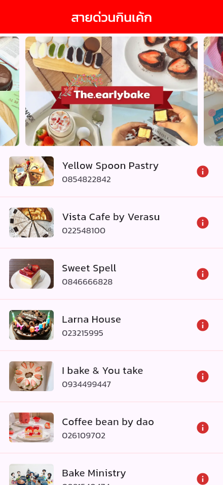
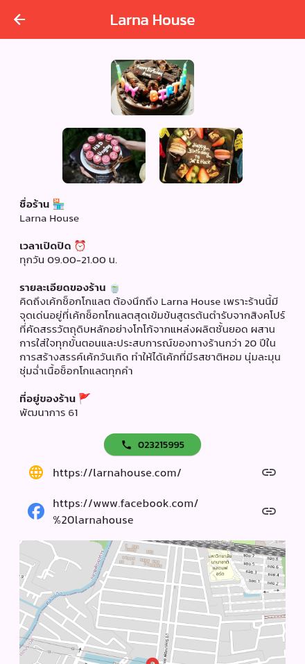
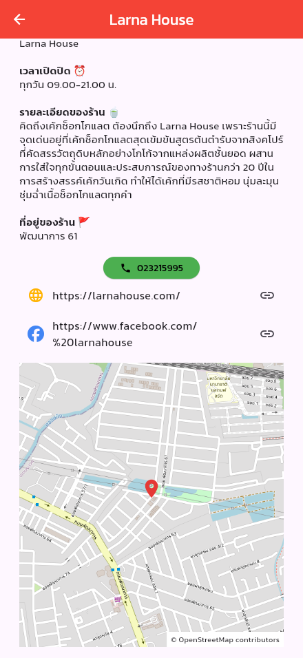

# สายด่วนกินเค้ก

สายด่วนกินเค้กเป็นแอปรวมข้อมูลร้านเค้ก 7 ร้านจากโจทย์รายวิชา พัฒนาด้วย Flutter และ Dart ผู้ใช้ดูรูป รายละเอียด และตำแหน่งร้านบนแผนที่ พร้อมเปิดช่องทางติดต่อจากหน้าร้านได้

## ฟังก์ชันการทำงาน

- แสดงหน้าเปิดแอปพร้อมภาพพื้นหลังและตัวบอกสถานะ แล้วไปหน้ารายการหลัง 3 วินาที
- หน้ารายการแสดงรูป ชื่อ และเบอร์โทรของทั้ง 7 ร้าน พร้อมแบนเนอร์ 7 ภาพที่ปัดได้และเปลี่ยนเองทุก 3 วินาทีเมื่อระบบอนุญาตให้เล่นแอนิเมชัน
- แตะแถวร้านหรือไอคอน ⓘ เพื่อดูรูป 3 ภาพ เวลาเปิดปิด รายละเอียด และที่อยู่ร้าน กดลูกศรบน AppBar เพื่อกลับหน้ารายการ
- ปุ่มโทรส่งเบอร์ร้านให้แอปโทรศัพท์ของอุปกรณ์ ส่วนลิงก์เปิดเว็บไซต์และ Facebook ของร้าน
- เลื่อนลงเพื่อดูแผนที่ OpenStreetMap และแตะหมุดเพื่อเปิดตำแหน่งร้านใน Google Maps

## ภาพหน้าจอแอปพลิเคชัน

ภาพจาก Flutter Web ใน Chrome Headless ขนาด 440 × 956 logical pixels ยกเว้นภาพรายละเอียด Bake Ministry ที่ขนาด 320 × 568 logical pixels

| หน้าเปิดแอป | รายการร้าน | รายละเอียดร้าน |
| :---: | :---: | :---: |
|  |  |  |

| Carousel หลังเปลี่ยนภาพ | แผนที่และข้อมูลติดต่อ | หน้าจอขนาดเล็ก |
| :---: | :---: | :---: |
|  |  |  |

## เทคโนโลยีที่ใช้

| เทคโนโลยี / Package | หน้าที่ |
| --- | --- |
| Flutter 3.50.0, Dart 3.14.0 และ `material_ui` | สร้าง UI และจัดการการนำทางระหว่างหน้าจอ |
| carousel_slider | แสดงแบนเนอร์ที่ปัดและเปลี่ยนภาพอัตโนมัติได้ |
| flutter_map, latlong2 และ OpenStreetMap | แสดงแผนที่และตำแหน่งร้าน |
| url_launcher | ส่งเบอร์โทรและลิงก์ไปยังแอปที่รองรับ |
| Kanit, Material Icons และ Font Awesome | แสดงข้อความภาษาไทยและไอคอน |
| flutter_launcher_icons | สร้างไอคอนแอปจากไฟล์ที่อาจารย์ให้ |
| flutter_test และ flutter_lints | ทดสอบการทำงานและตรวจโค้ด |

## โครงสร้างโปรเจกต์

| ไฟล์ | Class | หน้าที่ |
| --- | --- | --- |
| `lib/main.dart` | `FlutterCakeShopApp` | ตั้งค่าแอปและธีม |
| `lib/views/splash_screen_ui.dart` | `SplashScreenUI` | เปิดหน้ารายการด้วย `pushReplacement` |
| `lib/views/cake_shop_list_ui.dart` | `CakeShopListUI` | สร้างรายการและส่งออบเจ็กต์ร้านที่เลือกไปยังหน้ารายละเอียด |
| `lib/views/cake_shop_detail_ui.dart` | `CakeShopDetailUI` | แสดงรายละเอียดจากออบเจ็กต์ `CakeShop` ที่รับผ่าน constructor |
| `lib/models/cake_shop.dart` | `CakeShop` | เก็บข้อมูลร้าน |
| `lib/models/cake_shop_data.dart` | — | เก็บข้อมูลร้านและแบนเนอร์ใน `cakeShopData` และ `cakeShopBanners` |
| `lib/widgets/cake_shop_map.dart` | `CakeShopMap` | วางหมุดตามพิกัดของร้านที่เลือกและเปิด Google Maps เมื่อแตะ |

## การติดตั้งและใช้งาน

ใช้ Flutter SDK ที่รองรับ Dart `^3.14.0` ตาม `pubspec.yaml` เวอร์ชันที่ใช้ทดสอบคือ Flutter 3.50.0 ติดตั้ง Chrome แล้วรันคำสั่งจากโฟลเดอร์โปรเจกต์

```sh
flutter pub get
flutter run -d chrome
```

เลือกร้านจากรายการเพื่อดูรายละเอียด แตะปุ่มโทรหรือลิงก์เพื่อติดต่อร้าน หรือเลื่อนลงแล้วแตะหมุดเพื่อเปิดตำแหน่งใน Google Maps

## การทดสอบและข้อจำกัด

| รายการ | ผล |
| --- | --- |
| `flutter analyze` | ผ่านโดยไม่พบปัญหา |
| `flutter test` | ผ่าน 6/6 ครอบคลุมการนำทาง ข้อมูลและพิกัดร้าน แบนเนอร์ การเลื่อนบนหน้าจอเล็ก URI และการถอดรหัสรูป 30 ไฟล์ |
| Web build | สร้างสำเร็จ |
| Web runtime | ตรวจใน Chrome Headless ที่ 440 × 956 และ 320 × 568 logical pixels |
| Android build | สร้าง debug APK สำเร็จ |
| Android runtime | ทดสอบบน Android Emulator Pixel 8 Pro API 35 และยืนยันการส่งเบอร์ไปยังแอปโทรศัพท์โดยไม่ได้โทรออก |
| iOS และอุปกรณ์จริง | ยังไม่ได้ Build สำหรับ iOS และยังไม่ได้รันบน iOS หรืออุปกรณ์จริง |

ข้อมูลร้านและช่องทางติดต่ออ้างอิงชุดข้อมูลรายวิชา รายละเอียดและลิงก์อาจเปลี่ยนได้ ลิงก์ Facebook ของ Larna House คง `%20` ตามต้นฉบับ การเปิดเบอร์และลิงก์ขึ้นอยู่กับแอปที่อุปกรณ์รองรับ และแผนที่ต้องใช้อินเทอร์เน็ต

## เครดิตและสิทธิ์การใช้งาน

### ทรัพยากรจากอาจารย์และ Figma

ข้อมูลร้าน ภาพพื้นหลัง รูปร้าน แบนเนอร์ ไอคอน และหน้าจออ้างอิงจาก Resources และ Figma ของรายวิชา [Figma ของรายวิชา](https://www.figma.com/design/dDfSU6xj7OqYc8WXSyXXYm/Project--flutter_cake_shop_app?node-id=0-1)

### Fonts, Packages และ Open-source Licenses

- ฟอนต์ Kanit ของ The Kanit Project Authors ใช้ SIL Open Font License 1.1 และบรรจุในแอปเพื่อแสดงภาษาไทยจากไฟล์ในเครื่อง [โครงการ Kanit](https://github.com/cadsondemak/kanit) · [ไฟล์ OFL](assets/fonts/OFL.txt)
- ไอคอน Material มาจาก Flutter SDK [ไฟล์ License ที่แนบมากับ SDK](docs/licenses/materialicons.txt)
- ไอคอน Facebook มาจาก Font Awesome Free [Font Awesome Free License](https://fontawesome.com/license/free)

| Package | หน้าที่และ License |
| --- | --- |
| `material_ui` 1.11.1 | ส่วนประกอบ Material สำหรับหน้าจอ · [BSD-3-Clause](docs/licenses/material_ui-1.11.1.txt) |
| `carousel_slider` 5.1.2 | Carousel ที่ปัดและเล่นอัตโนมัติ · [MIT](docs/licenses/carousel_slider-5.1.2.txt) |
| `flutter_map` 8.3.2 และ `latlong2` 0.9.1 | แสดงแผนที่และพิกัดร้าน · [BSD-3-Clause](docs/licenses/flutter_map-8.3.2.txt) · [Apache-2.0](docs/licenses/latlong2-0.9.1.txt) |
| `url_launcher` 6.3.3 | เปิดแอปโทร เว็บไซต์ Facebook และ Google Maps · [BSD-3-Clause](docs/licenses/url_launcher-6.3.3.txt) |
| `font_awesome_flutter` 11.0.0 | ไอคอน Facebook · [MIT สำหรับตัว package, CC BY 4.0 สำหรับไอคอน และ SIL OFL 1.1 สำหรับฟอนต์](docs/licenses/font_awesome_flutter-11.0.0.txt) |
| `flutter_launcher_icons` 0.14.4 | สร้างไอคอนแอป Android, iOS และ Web · [MIT](docs/licenses/flutter_launcher_icons-0.14.4.txt) |
| `flutter_lints` 6.0.0 | กฎตรวจโค้ดสำหรับพัฒนา · [BSD-3-Clause](docs/licenses/flutter_lints-6.0.0.txt) |

### Third-party Assets และ Trademarks

- ภาพร้าน แบนเนอร์ ชื่อร้าน และเครื่องหมายการค้า รวมถึงเครื่องหมาย Facebook ของ Meta ใช้ประกอบโปรเจกต์เพื่อการศึกษา สิทธิ์เป็นของเจ้าของแต่ละราย ชุด Resources ไม่มีสัญญาอนุญาตแยกสำหรับภาพร้าน และสิทธิ์เผยแพร่ซ้ำจากเจ้าของภาพยังไม่ได้รับการยืนยัน
- ข้อมูลแผนที่ © OpenStreetMap contributors อยู่ภายใต้ Open Database License แอปแสดงเครดิตบนแผนที่และโหลด tile ตามนโยบายของบริการ [เครดิตและสิทธิ์ OpenStreetMap](https://www.openstreetmap.org/copyright) · [นโยบาย tile](https://operations.osmfoundation.org/policies/tiles/)
